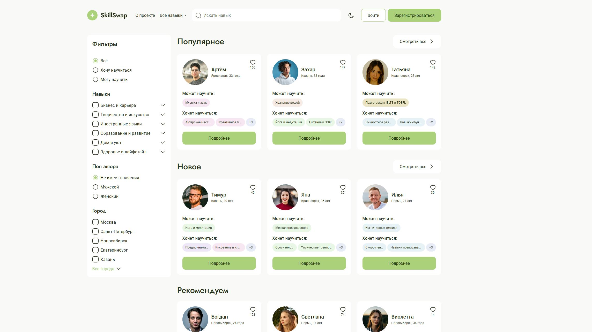
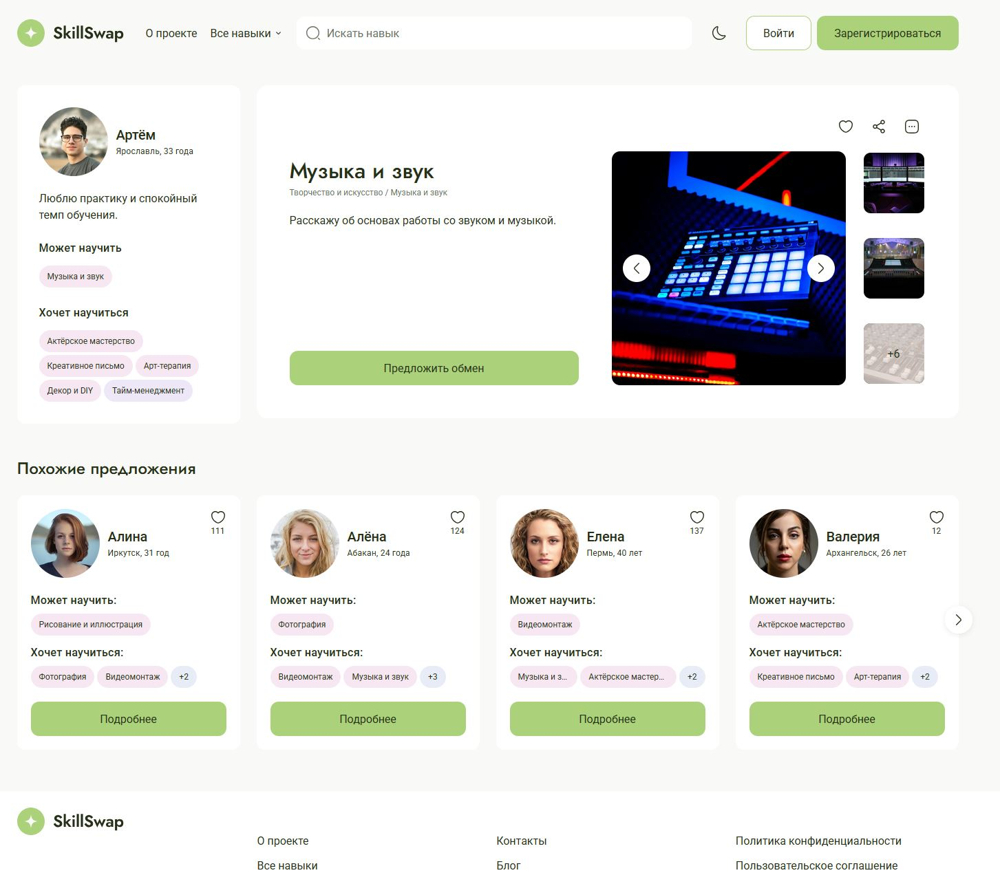
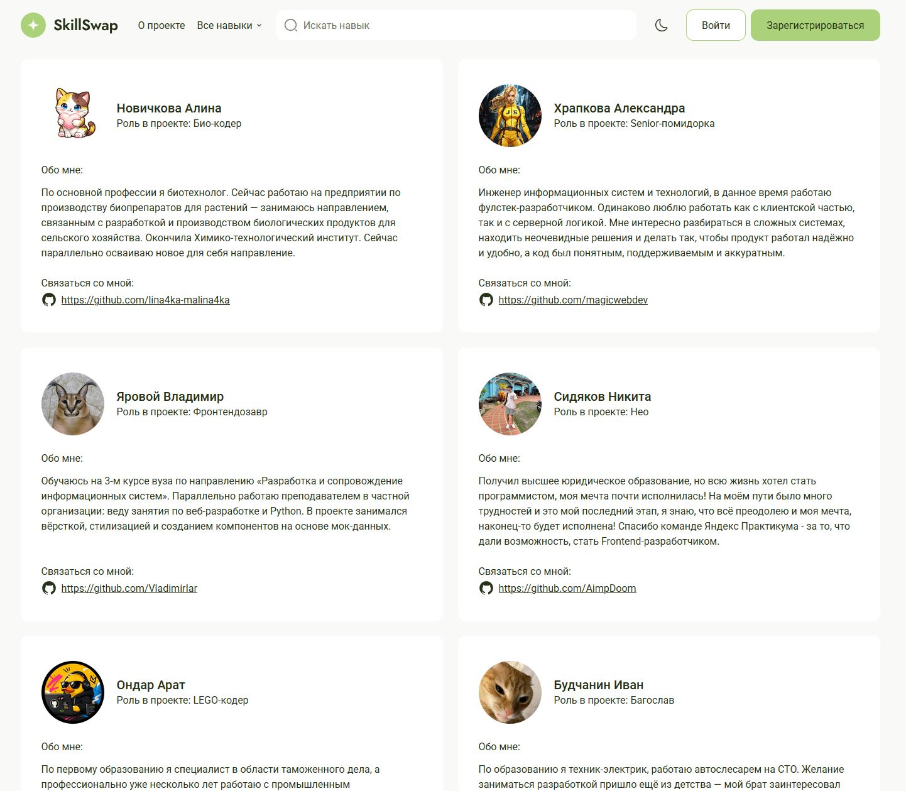

# SkillSwap


SkillSwap is a web application that connects users interested in exchanging skills and knowledge. Users can create profiles, browse other users, discover new skills, and send exchange requests.

The project was developed by a team using React, TypeScript, and the Feature-Sliced Design (FSD) architecture.

---

## ✨ Features

- User authentication and authorization
- User profile management
- Browse users and skills
- Search users by skills
- Favorites management
- Skill exchange requests
- Responsive user interface

---

## 🛠️ Tech Stack

- React
- TypeScript
- Redux Toolkit
- React Router
- Feature-Sliced Design (FSD)
- Vite
- ESLint
- Stylelint
- Prettier
- GitHub Actions

---

## 👨‍💻 My Contribution

As part of the development team, I:

- Participated in designing the application architecture using Feature-Sliced Design (FSD).
- Implemented user profile functionality.
- Developed reusable UI components.
- Integrated REST API into the application.
- Collaborated with the team using Git Flow, Pull Requests, and Code Review.

---

## 📸 Screenshots

### Home Page



### Profile Page



### Contacts



---

## 🚀 Installation

Clone the repository:

```bash
git clone https://github.com/AimpDoom/SkillSwap_55_2.git
```

Navigate to the project folder:

```bash
cd SkillSwap_55_2
```

Install dependencies:

```bash
npm install
```

Start the development server:

```bash
npm run dev
```

The application will be available at:

```
http://localhost:5173
```

---

## 📁 Project Structure

The project follows the **Feature-Sliced Design (FSD)** architecture, providing a scalable and maintainable codebase.

```
src/
├── app/
├── entities/
├── features/
├── pages/
├── shared/
└── widgets/
```

---

## 🤝 Team Workflow

The project was developed following a collaborative workflow using:

- Git Flow
- Pull Requests
- Code Review
- GitHub Actions

---

## 📄 License

Educational project created as part of frontend development practice.
